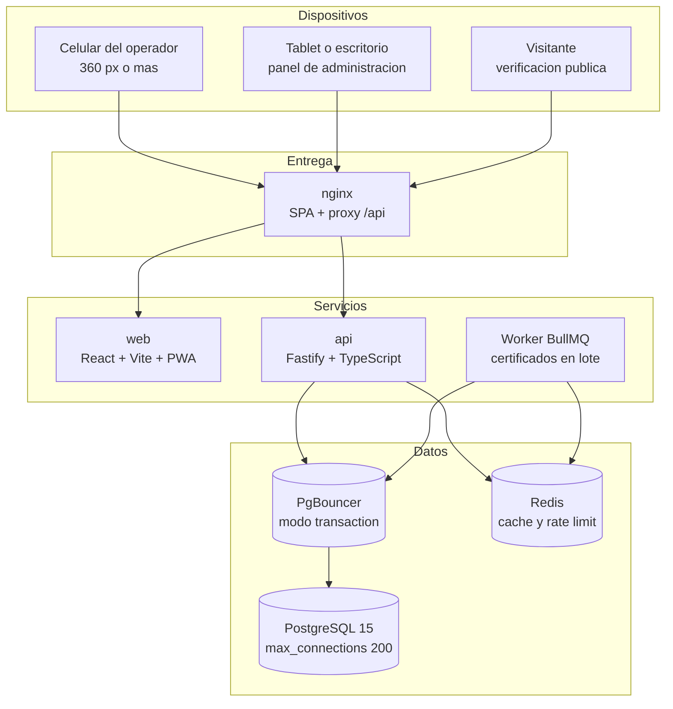

# Sistema de control de asistencia, refrigerios y certificados

Sistema para el control de asistencia de un seminario universitario con cerca de 600
participantes, dos jornadas, entrega de refrigerios sin duplicados y emision de
certificados **exclusivamente por parte del administrador**.

La interfaz, los mensajes y la documentacion estan en espanol (Colombia) y la zona
horaria de negocio es `America/Bogota`.

---

## 1. Que hace el sistema

| Modulo                      | Quien lo usa  | Que resuelve                                                                                                                      |
| --------------------------- | ------------- | --------------------------------------------------------------------------------------------------------------------------------- |
| **Registro de asistencia**  | Operador      | Ingreso y salida por ID institucional (teclado o QR). Un solo registro por asistente y jornada, garantizado por la base de datos. |
| **Entrega de refrigerios**  | Operador      | Una entrega por asistente y tipo de refrigerio, solo si tiene asistencia en la jornada correspondiente.                           |
| **Panel de administracion** | Administrador | Dashboard en vivo, padron de asistentes, importacion masiva, carnets con QR, configuracion del evento, reportes y usuarios.       |
| **Certificados**            | Administrador | Emision individual y masiva con barra de progreso, descarga en PDF o ZIP y revocacion auditada.                                   |
| **Verificacion publica**    | Cualquiera    | Pagina publica que confirma la autenticidad de un certificado mediante su codigo.                                                 |

### Como identifica el sistema a un asistente

Cada asistente tiene tres datos, cargados previamente por el administrador:

| Dato                   | Origen                                                                                 | Uso                                                                     |
| ---------------------- | -------------------------------------------------------------------------------------- | ----------------------------------------------------------------------- |
| **ID institucional**   | Cedula o codigo estudiantil de la universidad                                          | Clave de negocio, inmutable.                                            |
| **Codigo de registro** | **Lo genera el sistema**: 6 caracteres sin `O`, `I`, `0` ni `1` (por ejemplo `K7M4D2`) | Es lo que codifica el QR y lo que el operador dicta. Unico e inmutable. |
| **Correo electronico** | Institucional del estudiante                                                           | Destino del codigo de registro y del QR.                                |

La app del operador acepta **cualquiera de los dos** en el mismo campo y, antes de registrar,
**muestra el nombre del asistente** para contrastarlo con la escarapela y con la persona.

Reglas que el sistema garantiza y que no dependen del comportamiento de la interfaz:

- Es **imposible** registrar dos ingresos en la misma jornada ni dos entregas del
  mismo refrigerio, aunque lleguen peticiones simultaneas.
- Un certificado **solo** se emite a un asistente elegible, salvo excepcion manual del
  administrador con motivo obligatorio (queda auditado).
- Cambiar la hora de fin o la tolerancia **recalcula** la elegibilidad de inmediato, sin
  migraciones ni scripts.

---

## 2. Evento de referencia

El sistema se parametriza por evento. La configuracion de ejemplo corresponde al:

| Dato      | Valor                                                        |
| --------- | ------------------------------------------------------------ |
| Evento    | IV Seminario de Ingenieria de Software                       |
| Organiza  | Facultad de Ingenieria - Universidad Cooperativa de Colombia |
| Fecha     | 27 de octubre de 2026                                        |
| Horario   | 8:00 a.m. a 6:00 p.m. (8 horas)                              |
| Modalidad | Presencial                                                   |
| Lugar     | Camara de Comercio - Pasto                                   |
| Contacto  | 311 781 7327                                                 |

Todo esto se configura desde el panel (nombre, fecha, hora de fin, tolerancia, jornadas,
lugar, facultad y **hasta tres firmantes** del certificado), no en el codigo.

---

## 3. Arquitectura



- El navegador guarda el token de acceso en memoria y el refresh token en cookie
  `httpOnly`. La API nunca expone datos personales sin sesion valida.
- La app del operador es una **PWA**: instala, funciona sin conexion con una cola local
  (IndexedDB) y sincroniza al volver la red.
- Las escrituras criticas se resuelven con una sola sentencia atomica apoyada en
  constraints `UNIQUE`; nunca "consultar y luego insertar".

Detalle completo en [`docs/01-arquitectura.md`](docs/01-arquitectura.md).

---

## 4. Puesta en marcha

### 4.1 Requisitos

- Docker Desktop 24 o superior (con Compose v2).
- Node.js 20.11 o superior (solo para desarrollo fuera de Docker).
- 4 GB de RAM disponibles para los contenedores.

### 4.2 Con Docker (camino recomendado)

```bash
git clone <repositorio> proyectoAsistencia
cd proyectoAsistencia
cp .env.example .env
```

Edite `.env` y defina como minimo `JWT_SECRET` (32 caracteres o mas). Puede generarlo con:

```bash
openssl rand -base64 48
```

Levante la plataforma completa:

```bash
docker compose up -d --build
```

El sistema queda disponible en:

| Servicio               | URL                                    |
| ---------------------- | -------------------------------------- |
| Aplicacion (web + API) | http://localhost:8080                  |
| API directa            | http://localhost:3000                  |
| Documentacion OpenAPI  | http://localhost:8080/api/docs         |
| Verificacion publica   | http://localhost:8080/verificar/CODIGO |

La base de datos se prepara sola al arrancar: el contenedor de la API aplica las migraciones pendientes
y crea los datos iniciales (administrador, operadores, configuracion y jornadas) si la base esta
vacia. Para cargar los 600 asistentes ficticios de la prueba de carga hay que ejecutar el seed:

```bash
docker compose exec api node dist/db/seed.js
```

Las credenciales iniciales salen de `ADMIN_EMAIL` y `ADMIN_PASSWORD` del `.env`.
**Cambielas antes de usarlo en un evento real.**

### 4.3 En desarrollo (sin Docker)

```bash
npm install
cp .env.example .env
docker compose up -d postgres pgbouncer redis   # solo la infraestructura de datos
npm run migrate        # opcional: el arranque de la API tambien migra
npm run seed           # administrador + 600 asistentes de ejemplo
npm run dev            # API en :3000 y web en :5173
```

### 4.4 Despliegue en produccion con Dokploy

El repositorio incluye un compose listo para Dokploy con todo el sistema (PostgreSQL, PgBouncer,
Redis, API y frontend):

```bash
# En Dokploy: Create Service > Docker Compose
#   Repository   : fernandorosero91/controlAsistencia
#   Branch       : main
#   Compose Path : docker-compose.dokploy.yml
#   Environment  : contenido de .env.dokploy.example, ajustado
```

Solo el servicio `web` publica puerto; el dominio con HTTPS se asigna en Dokploy apuntando a
`web:80`. La guia paso a paso (variables, dominio, datos iniciales, respaldos y diagnostico) esta en
[`docs/09-despliegue-dokploy.md`](docs/09-despliegue-dokploy.md).

Al desplegar no hay que ejecutar nada: el entrypoint de la API
([`infra/docker/entrada-api.sh`](infra/docker/entrada-api.sh)) aplica las migraciones pendientes y crea
el administrador, los operadores y la configuracion la primera vez. El servicio `seed` queda solo para
resembrar a proposito (por ejemplo, agregar operadores):

```bash
docker compose -f docker-compose.dokploy.yml --profile datos run --rm seed
```

### 4.5 Scripts disponibles

| Comando                                                 | Que hace                                                                       |
| ------------------------------------------------------- | ------------------------------------------------------------------------------ |
| `npm run dev`                                           | Levanta API y web con recarga en caliente.                                     |
| `npm run build`                                         | Compila el paquete compartido, la API y la web.                                |
| `npm start`                                             | Ejecuta la API compilada.                                                      |
| `npm test`                                              | Pruebas unitarias de los tres paquetes.                                        |
| `npm run test:integration`                              | Pruebas de integracion (incluye concurrencia real).                            |
| `npm run test:e2e`                                      | Pruebas de extremo a extremo con Playwright.                                   |
| `npm run lint` / `npm run format`                       | ESLint y Prettier.                                                             |
| `npm run typecheck`                                     | Verificacion de tipos de todo el monorepo.                                     |
| `npm run migrate` / `migrate:revert` / `migrate:status` | Migraciones reversibles (el arranque de la API ya las aplica).                 |
| `npm run bootstrap`                                     | Crea los datos iniciales solo si la base esta vacia.                           |
| `npm run seed`                                          | Datos de arranque (incluye los asistentes ficticios).                          |
| `npm run load-test`                                     | Pruebas de carga (k6 si esta instalado; si no, planificador Node equivalente). |
| `npm run docker:up` / `docker:down` / `docker:logs`     | Ciclo de vida de los contenedores.                                             |

---

## 5. Variables de entorno

Todas las variables estan documentadas en [`.env.example`](.env.example). Las
obligatorias son:

| Variable           | Para que sirve                                                                                                       |
| ------------------ | -------------------------------------------------------------------------------------------------------------------- |
| `DATABASE_URL`     | Conexion a PostgreSQL. En produccion debe apuntar a PgBouncer.                                                       |
| `JWT_SECRET`       | Firma de los tokens de acceso. Minimo 32 caracteres.                                                                 |
| `REDIS_URL`        | Cache compartida y rate limit distribuido. Opcional: sin Redis el sistema funciona con cache en memoria por proceso. |
| `CORS_ORIGINS`     | Origenes permitidos, separados por coma.                                                                             |
| `BASE_URL_PUBLICA` | URL con la que se construyen el QR de verificacion y los enlaces del certificado.                                    |
| `COOKIE_SECURE`    | `true` en produccion (obligatorio si el sitio usa HTTPS).                                                            |

Secretos adicionales recomendados en produccion: `POSTGRES_PASSWORD`,
`ADMIN_PASSWORD`, `JWT_REFRESH_TTL_SEGUNDOS`.

---

## 6. Manual del dia del evento

Resumen operativo; la version completa esta en
[`docs/03-operacion-dia-evento.md`](docs/03-operacion-dia-evento.md).

### 6.1 Antes de abrir las puertas (2 horas antes)

1. Verifique que `docker compose ps` muestre **todos** los servicios en `healthy`.
2. Abra `http://localhost:8080/api/health/ready` y confirme `{"estado":"ok","baseDatos":true}`.
3. Entre como administrador y en **Configuracion**:
   - confirme el nombre del seminario y la fecha;
   - ajuste la **hora de fin** (por ejemplo `18:00`) y la **tolerancia** (por ejemplo 15 minutos);
   - confirme que las dos jornadas tienen su ventana de check-in correcta;
   - deje activo "Permitir registro fuera de la ventana" si espera filas o retrasos.
4. Genere los **carnets con QR** (Administracion > Carnets > Descargar PDF) e
   imprimalos.
5. Entre como **operador** desde el celular y compruebe que el campo de ID se enfoca
   solo: haga un registro de prueba y luego **borre ese registro** desde la base de
   datos o use un ID de prueba.

### 6.2 Durante el evento

- El operador elige el modo (**Ingreso**, **Refrigerio**, **Salida**) una sola vez y
  despues solo digita o escanea el ID o el codigo de 6 caracteres.
- La app **verifica y muestra el nombre** del asistente: el operador lo compara con la
  escarapela y con la persona antes de confirmar. Es la barrera contra registrar a otra
  persona.
- Un duplicado **no es un error**: aparece una alerta ambar con la hora del registro
  original y el operador que lo hizo. Continúe con el siguiente estudiante.
- Si un ID no existe, la pantalla ofrece la busqueda manual por nombre.
- Al final de cada jornada, registre las **salidas** en el modo Salida: son las que
  determinan la elegibilidad del certificado.

### 6.3 Al cerrar

1. Registre todas las salidas pendientes.
2. En **Certificados**, revise el filtro "No elegibles" y valide los motivos.
3. Emita en lote y espere la barra de progreso al 100 %.
4. Descargue el ZIP y distribuyalo.
5. Exporte los reportes de asistencia y refrigerios en PDF y CSV.

---

## 7. Plan de contingencia

| Falla                                       | Detected en                                          | Respuesta inmediata                                                                                                                                                                                           | Respuesta definitiva                                                                                                              |
| ------------------------------------------- | ---------------------------------------------------- | ------------------------------------------------------------------------------------------------------------------------------------------------------------------------------------------------------------- | --------------------------------------------------------------------------------------------------------------------------------- |
| **Se cae internet**                         | Indicador "Sin conexion" en la app del operador      | La app guarda el registro en el dispositivo (IndexedDB) con clave de idempotencia y lo sincroniza al volver la red. Los duplicados que se detecten al sincronizar se muestran como **conflicto** al operador. | Sincronizacion automatica cada 15 s. Verificar que no queden registros pendientes antes de emitir certificados.                   |
| **Se cae la base de datos**                 | `/health/ready` responde 503; el panel muestra error | La API responde 503 sin caerse. El operador sigue registrando en su cola offline.                                                                                                                             | `docker compose restart postgres` (los datos estan en volumen). Si no levanta, `docker compose up -d postgres` y revise los logs. |
| **Se cae la API**                           | El panel marca error de red                          | El operador continua en modo offline.                                                                                                                                                                         | `docker compose restart api`. El proceso termina de forma ordenada (graceful shutdown) y las colas BullMQ se reanudan.            |
| **PgBouncer no responde**                   | La API reporta timeout de conexion                   | La API cae a la conexion directa si se configura `DATABASE_URL` con el host de Postgres.                                                                                                                      | Revise `docker compose logs pgbouncer` y las conexiones disponibles en Postgres.                                                  |
| **Redis no responde**                       | Log "Redis no disponible"                            | La API sigue operando con cache en memoria y rate limit local.                                                                                                                                                | `docker compose restart redis`.                                                                                                   |
| **Se emite un certificado por error**       | Panel de certificados                                | Use **Revocar** con motivo: la verificacion publica pasa a "no valido" y queda auditado.                                                                                                                      | Re-emita el certificado corregido.                                                                                                |
| **Se pierde el dispositivo de un operador** | Panel de asistencia                                  | La sesion caduca en 15 minutos; las operaciones se reasignan a otro operador.                                                                                                                                 | Cambie la contrasena del usuario en **Usuarios** y desactive la cuenta.                                                           |

---

## 8. Seguridad y datos personales

- Contrasenas con **argon2id**; nunca se registran en claro.
- **JWT de 15 minutos** + refresh token rotativo en cookie `httpOnly`, `SameSite=Lax` y
  `Secure` en produccion.
- **RBAC estricto**: `admin` (todo) y `operador` (registros y lectura de contexto).
  Emitir, descargar o revocar certificados exige rol `admin`.
- Todos los endpoints de escritura validan con **Zod** y usan consultas parametrizadas.
- **Ley 1581 de 2012 (Habeas Data)**: los datos se usan unicamente para el control de
  asistencia del evento, el acceso esta restringido a los roles autorizados y toda
  accion sensible queda en la tabla de auditoria.
- El QR codifica un ID institucional predecible: por eso **ningun dato personal se
  expone sin sesion** y la unica superficie publica es la verificacion de
  certificados, con rate limit por IP.

---

## 9. Estructura del repositorio

```
proyectoAsistencia/
  AGENTS.md              # documento rector: contexto, restricciones y decisiones
  docker-compose.yml     # desarrollo local (infraestructura publicada en 127.0.0.1)
  docker-compose.dokploy.yml  # despliegue de produccion para Dokploy
  .env.example           # variables de desarrollo
  .env.dokploy.example   # variables de produccion (Dokploy)
  apps/
    api/                 # Fastify, Drizzle, servicios, migraciones y pruebas
    web/                 # React, Vite, Tailwind, PWA, app del operador y panel
  packages/
    shared/              # contratos: tipos y esquemas Zod compartidos
  infra/
    docker/              # Dockerfile de la API, la web y PgBouncer
    nginx/               # proxy inverso y entrega de la SPA
    pgbouncer/           # configuracion del pooler
  docs/                  # arquitectura, reglas, diseno, operacion y pruebas
  e2e/                   # Playwright (incluye viewport movil 360x640)
  load-tests/            # k6 y planificador Node equivalente
  scripts/               # utilidades (iconos, prueba de humo)
```

---

## 10. Documentacion

| Documento                                                            | Contenido                                                                           |
| -------------------------------------------------------------------- | ----------------------------------------------------------------------------------- |
| [`docs/01-arquitectura.md`](docs/01-arquitectura.md)                 | Componentes, flujo de datos, pool de conexiones, cache, idempotencia y resiliencia. |
| [`docs/02-decisiones-tecnicas.md`](docs/02-decisiones-tecnicas.md)   | Decisiones con sus alternativas, trade-offs y estado de la regla de degradados.     |
| [`docs/03-operacion-dia-evento.md`](docs/03-operacion-dia-evento.md) | Manual operativo completo y plan de contingencia.                                   |
| [`docs/04-reglas-negocio.md`](docs/04-reglas-negocio.md)             | Reglas de asistencia, refrigerios y elegibilidad del certificado.                   |
| [`docs/05-guia-diseno.md`](docs/05-guia-diseno.md)                   | Paleta, tipografia, iconos, componentes y accesibilidad.                            |
| [`docs/06-pruebas-carga.md`](docs/06-pruebas-carga.md)               | Resultados medidos de las pruebas de carga.                                         |
| [`docs/07-manuales.md`](docs/07-manuales.md)                         | Manual breve para administrador y operador.                                         |
| [`docs/08-pruebas.md`](docs/08-pruebas.md)                           | Como ejecutar cada tipo de prueba y que se verifica en cada una.                    |
| [`docs/09-despliegue-dokploy.md`](docs/09-despliegue-dokploy.md)     | Despliegue en Dokploy: compose, variables, dominio, respaldos y diagnostico.        |
