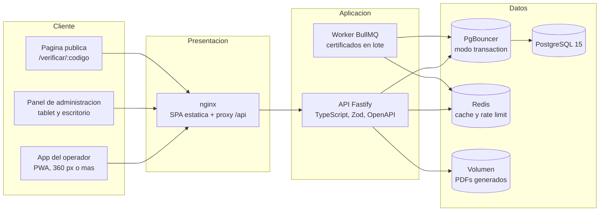
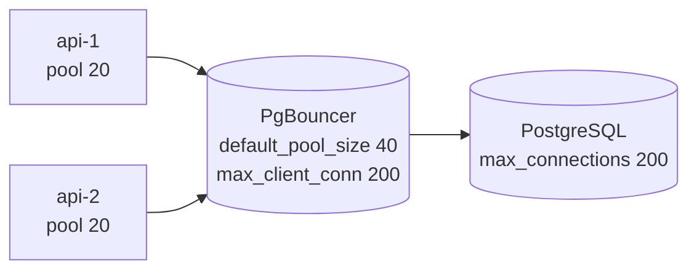

# Arquitectura

## 1. Vista general



## 2. Componentes

| Componente        | Tecnologia                          | Responsabilidad                                                         |
| ----------------- | ----------------------------------- | ----------------------------------------------------------------------- |
| `apps/web`        | React 18, Vite, Tailwind, PWA       | App del operador, panel de administracion y verificacion publica.       |
| `apps/api`        | Fastify 5, TypeScript, Zod, Drizzle | API HTTP, reglas de negocio, generacion de PDF y cola de emision.       |
| `packages/shared` | TypeScript, Zod                     | Contratos compartidos: esquemas de validacion, tipos y reglas puras.    |
| `infra/pgbouncer` | PgBouncer 1.22                      | Pool de conexiones en modo `transaction`.                               |
| `infra/nginx`     | nginx 1.27                          | Entrega la SPA, aplica compresion y hace de proxy inverso hacia la API. |
| `load-tests`      | k6 y planificador Node              | Pruebas de carga de check-in, dashboard y certificados.                 |

## 3. Flujo de un registro de asistencia

1. El operador digita el **ID institucional** (cedula o codigo estudiantil) o el **codigo de
   registro** de 6 caracteres, o escanea el QR con la camara.
2. La app envia `POST /asistencias/ingreso` con la cabecera `Idempotency-Key`.
3. La API busca al asistente por `id` **o** por `codigo_registro`.
4. La API ejecuta **una sola sentencia atomica**:

   ```sql
   INSERT INTO asistencias (asistente_id, jornada_id, hora_ingreso, ...)
   VALUES (...)
   ON CONFLICT (asistente_id, jornada_id) DO NOTHING
   RETURNING id;
   ```

5. Si `RETURNING` no trae filas, el registro ya existia: la API consulta el original y
   responde `200` con `resultado: "duplicado"` y los datos de quien lo registro.
6. La app muestra el bloque de resultado (verde, ambar o rojo), limpia el campo y lo
   reenfoca.

**Nunca** hay un "consultar y luego insertar": la garantia de unicidad la impone el
indice unico `asistencias_unico_asistente_jornada`.

## 4. Datos

### 4.1 Tablas

| Tabla                 | Contenido                     | Restricciones clave                                                                                |
| --------------------- | ----------------------------- | -------------------------------------------------------------------------------------------------- |
| `asistentes`          | Padron del seminario          | PK textual `id`; `codigo_registro` unico e inmutable; `email` opcional; CHECK de semestre por rol. |
| `seminario_config`    | Parametros del evento         | Una sola fila (`id = 1`); `firmas` JSONB con hasta 3 firmantes.                                    |
| `jornadas`            | Manana y tarde                | CHECK de coherencia de horarios y ventanas.                                                        |
| `asistencias`         | Ingresos y salidas            | `UNIQUE (asistente_id, jornada_id)`.                                                               |
| `tipos_refrigerio`    | Refrigerios por jornada       | Unico por nombre y jornada.                                                                        |
| `entregas_refrigerio` | Entregas                      | `UNIQUE (asistente_id, tipo_refrigerio_id)`.                                                       |
| `certificados`        | Certificados emitidos         | Unico por asistente y por codigo de verificacion.                                                  |
| `certificados_lotes`  | Progreso de la emision masiva | Estado y contadores.                                                                               |
| `usuarios_sistema`    | Administradores y operadores  | `argon2id`, rol y estado.                                                                          |
| `refresh_tokens`      | Rotacion de sesiones          | Solo se guarda el hash SHA-256.                                                                    |
| `auditoria`           | Acciones sensibles            | Usuario, accion, entidad, IP y datos antes/despues.                                                |
| `idempotencia`        | Respuestas repetidas          | `UNIQUE (usuario_id, endpoint, clave)`.                                                            |
| `schema_migrations`   | Migraciones aplicadas         | Version y checksum.                                                                                |

El DDL canonico esta en `apps/api/drizzle/*.sql`; el esquema tipado equivalente esta en
`apps/api/src/db/esquema.ts`.

### 4.2 Indices pensados para las consultas del dia del evento

- `asistencias (jornada_id, hora_ingreso)`: asistencia por jornada y ritmo de ingreso.
- `asistencias (asistente_id, jornada_id)` unico: garantia de no duplicado.
- `entregas_refrigerio (tipo_refrigerio_id, entregado_at)`: progreso de refrigerios.
- `asistentes` con `pg_trgm` sobre `nombres || ' ' || apellidos`: busqueda por nombre.
- `asistentes (lower(email))` parcial: envio de QR y comunicacion.
- `asistentes (codigo_registro)` unico parcial: busqueda por codigo corto.

## 5. Pool de conexiones y dimensionamiento



| Parametro                     | Valor                   | Motivo                                                                                                                                                                      |
| ----------------------------- | ----------------------- | --------------------------------------------------------------------------------------------------------------------------------------------------------------------------- |
| `DATABASE_POOL_MAX`           | 20 por instancia        | El pico son 600 check-ins en 3 minutos: unas 4 escrituras por segundo, muy por debajo del limite. El pool se dimensiona para el caso Moderate, no para el pico instantaneo. |
| `DATABASE_POOL_MIN`           | 2                       | Mantiene conexiones vivas sin reserva de memoria innecesaria.                                                                                                               |
| `connectionTimeoutMillis`     | 5000                    | Falla rapido si la base no responde.                                                                                                                                        |
| `idleTimeoutMillis`           | 30000                   | Libera conexiones ociosas.                                                                                                                                                  |
| `statement_timeout`           | 10 s (15 s en reportes) | Corta consultas patologicas.                                                                                                                                                |
| PgBouncer `default_pool_size` | 40                      | 2 replicas x 20 conexiones de aplicacion.                                                                                                                                   |
| PgBouncer `max_client_conn`   | 200                     | Margen para herramientas y para Growth.                                                                                                                                     |
| Postgres `max_connections`    | 200                     | Margen sobre las 80 conexiones reales de PgBouncer.                                                                                                                         |

Si se opera con una sola replica, `DATABASE_POOL_MAX=20` y PgBouncer `default_pool_size=20`
son suficientes.

## 6. Cache y rate limit

- **Redis** es el almacen compartido: cache del panel (TTL 3 s) y rate limit distribuido.
- **Sin Redis** la API sigue funcionando: la cache cae a un almacen en memoria **por proceso**
  (solo afecta el rendimiento del dashboard, nunca la integridad) y el rate limit es local.
  Es una limitacion documentada: con varias réplicas, el limite se aplica por replica.
- El dashboard responde con `ETag`; el cliente envia `If-None-Match` y recibe `304` cuando no
  hay cambios, de modo que el polling de 10 administradores no golpea la base de datos.

## 7. Idempotencia

Dos mecanismos complementarios:

1. **Cabecera `Idempotency-Key`** en los endpoints de escritura. La API guarda la primera
   respuesta en la tabla `idempotencia` y devuelve exactamente la misma si la peticion se
   repite con la misma clave. Es lo que permite a la app del operador reintentar sin miedo.
2. **Constraints `UNIQUE`** en la base de datos. Son la garantia real: aunque la clave de
   idempotencia se pierda, el segundo registro no se crea.

## 8. Cola de emision masiva

- Con Redis: cola **BullMQ** (`certificados-lote`), reintentos exponenciales y concurrencia
  limitada a 2 lotes en paralelo.
- Sin Redis: el lote se procesa en el proceso de la API con la misma mecanica de progreso.
- El progreso vive en `certificados_lotes` (consultable por HTTP) y cada elemento se guarda
  su PDF en disco (`CERTIFICADOS_DIR`) para no regenerarlo en cada descarga.
- Un fallo individual se registra en la columna `errores` y **el lote continua**.

## 9. Resiliencia

| Mecanismo       | Detalle                                                                              |
| --------------- | ------------------------------------------------------------------------------------ |
| Health checks   | `GET /health/live` (proceso vivo) y `GET /health/ready` (base de datos).             |
| Cierre ordenado | `SIGTERM` y `SIGINT` cierran el pool y la cola antes de salir.                       |
| Reintentos      | El cliente HTTP reintenta con espera creciente (300 ms, 800 ms, 1600 ms).            |
| Cola offline    | La PWA guarda los registros en IndexedDB y sincroniza cada 15 s.                     |
| Errores         | Manejador central con codigo estable, mensaje en espanol y `request-id` en los logs. |
| Logs            | `pino` con logs estructurados y ocultamiento de cabeceras sensibles.                 |
| Compresion      | `@fastify/compress` con gzip, brotli y deflate.                                      |
| Limites         | `bodyLimit` de 1 MB y carga de archivos de hasta 10 MB.                              |
| Paginacion      | Obligatoria en todos los listados (maximo 200 por pagina).                           |

## 10. Estructura del codigo de la API

```
apps/api/src/
  app.ts               # construccion de la aplicacion Fastify
  server.ts            # arranque y cierre ordenado
  config/              # entorno validado y logger
  db/                  # esquema Drizzle, cliente, migraciones y semilla
  lib/                 # validacion de entrada
  plugins/             # errores, autenticacion y RBAC
  rutas/               # endpoints por modulo
  servicios/           # reglas de negocio (registros, certificados, dashboard, correo...)
  trabajos/            # cola de emision masiva
  tipos.ts             # ampliacion de tipos de Fastify
```
